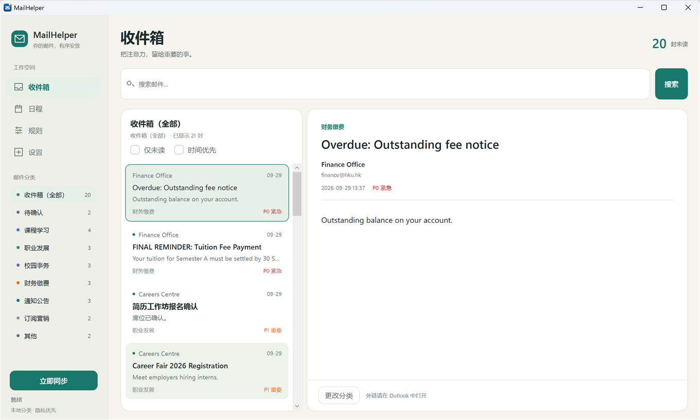
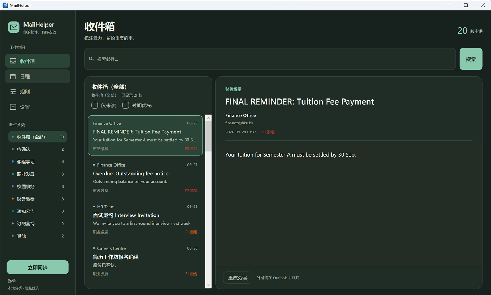

# MailHelper 0.11 桌面设计改版

2026-11-14。用户要求明显改善界面观感，并允许必要的配套功能修改。

## 备份与实施方案

起点是 `82caee5`，先创建并推送 `mailhelper-before-design-20261114` 标签；离线完整历史保存到 `F:/AICoding/_backups/mail_helper-before-design-20261114.bundle`，已通过 `git bundle verify`。

在 `codex/mailhelper-design-20261114` 分支实施，分工为主工作台、Avalonia 镜像、次级页面、独立设计 QA。先确定共同视觉语言，再重排页面与配套交互，最后验证真实窗口与打包。

## 设计取舍

- 暖纸背景 `#F5F4EF`、浅石绿侧栏 `#EDEFE8`、墨色正文 `#202B2B`、松绿强调 `#17786B`；深色使用对应的墨绿表面和高对比文字。
- 品牌、全局导航、分类、同步收进持久侧栏；主区域用于搜索、邮件队列与阅读，切换页面时导航位置稳定。
- 移除大彩色 emoji 方块与整行未读蓝底。未读靠字重与小圆点，选中靠淡绿表面和细边；重要度仍有可读文字。
- 阅读区采用纸张版式，清晰显示分类、主题、真实发件地址和完整本地时间。HTML 统一外侧留白，不再给每个直接子元素强塞卡片内边距。
- 日程分组卡、规则卡与设置分组使用同一套文字、留白、圆角和按钮；长内容可滚动，避免固定高度裁切保存按钮。
- Windows 与 Avalonia 保持同一设计语言，保留各平台原生阅读/控件机制，不新增外部字体、图片网络依赖或 UI 库。

## 配套改动

1. 修复日程刷新按钮绑定：原方法名生成 `RefreshCommandCommand`，页面却引用 `RefreshCommand`；现在直接从 `RefreshAsync` 生成正确命令，并有绑定断言。
2. Windows 补齐规则编辑入口、内置规则启停；规则编辑弹窗保留固定底部动作，正文可以滚动。
3. Avalonia 补回既有 VM 支持的勿扰时间、诊断开关与自定义分类颜色入口。
4. Windows 外观偏好在启动时实际加载浅/深色资源；`auto` 读取系统应用主题，设置说明明确重启生效。Avalonia 保持系统主题跟随。
5. DEV 实例的互斥与唤起管道按测试数据目录隔离，允许测试新版时保留已安装程序运行；生产实例规则不变。
6. 列表补完整发件地址和时间；跨年短日期带年份，移除“刚好七天前显示本周”的错误表述。更新保留选中时比较新增元信息。

没有更换同步渠道、分类引擎或数据结构；未触碰实际学校邮箱与 `G:/MailHelper` 安装目录。

## 验证结果

| 检查 | 结果 |
| --- | --- |
| Core / Services / Integration（排除 UI） | 106 / 109 / 83 项通过 |
| Mac 契约 / 共享 VM / Avalonia headless | 37 / 15 / 18 项通过 |
| WPF 真窗口浅/深主题 | 2 项通过，含 WebView2 实际正文、已读、日程、托盘唤起与最小窗搜索/列表边界 |
| 合计 | 370 项通过，0 失败 |
| Core 行覆盖 | 94.24%（687/729），仓库门禁为 80% |
| 平台边界与 diff whitespace | 通过 |

Avalonia 新增布局回归验证 980×620、1280×800、长主题/发件人/分类、可滚动设置、暗色与键盘 Tab 可见焦点；WPF 实际窗口按当前 DPI 调整最小尺寸再量取控件边界。截图均使用匿名种子。

保留已有三个 AVLN3001 构造器提示；增量构建可能显示零提示，不把它当成已经消除。没有声明真实 Mac 设备的 Outlook 或系统通知验收，也没有声称完成全部 WCAG 对比度审计。个别发送者自带 HTML 配色仍可能覆盖正文主题。

本机证据：各测试项目 `TestResults/design-final.trx` 与 `design-ui.trx`；原始截图在 `artifacts/screens/` 和 `artifacts/screens/avalonia/`。

## 实际窗口

下图从通过测试的真实 Windows 窗口截图裁去桌面边缘，并缩小到 1360px 展示；不是概念效果图。

## 交付与回退

源码推送 main 后按现有流程生成 0.11.0 beta，正式版仍由版本标签发布。此次没有自动替换电脑上运行的旧版；使用新版安装包或便携包时先退出旧版。

回退使用本轮提交的 `git revert`，或从备份标签新建分支查看旧代码；保留共享历史，不强推覆盖。离线 bundle 可克隆到新目录恢复。
