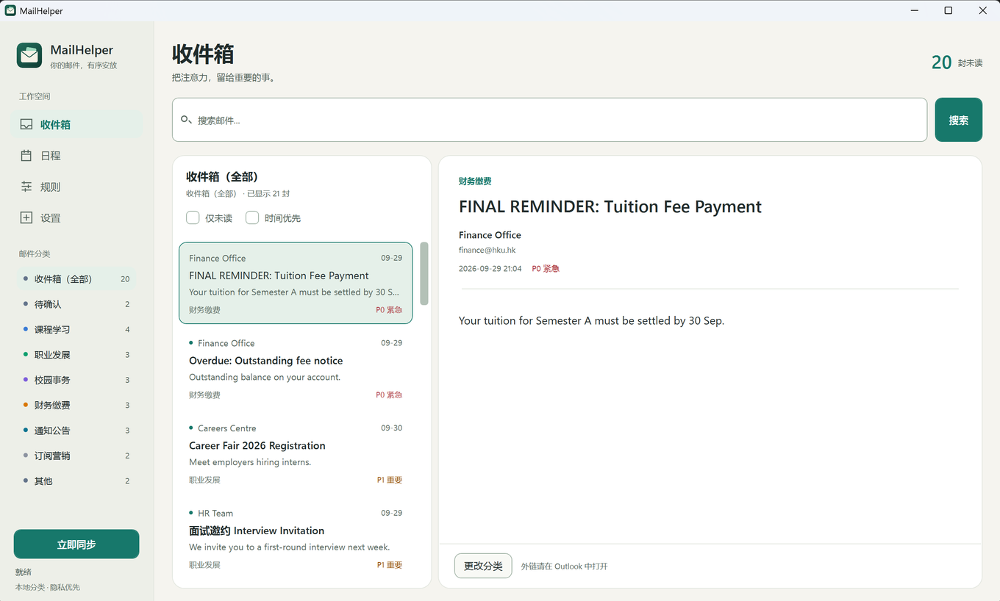
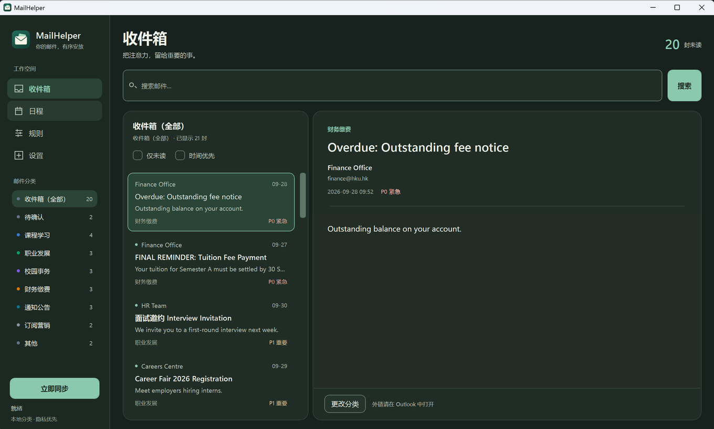

# 0.11.1 主题修复与品牌图标

日期：2026-11-17。用户反馈部分按钮未统一、夜间文字看不清，以及希望替换软件图标。

## 备份

起点 `774b99d`。备份标签 `mailhelper-before-polish-20261117` 已推到远端；完整离线历史在 `F:/AICoding/_backups/mail_helper-before-polish-20261117.bundle`，已通过 `git bundle verify`。实施分支为 `codex/mailhelper-theme-icon-20261117`。

## 修复内容

- **控件统一**：WPF 将按钮、输入框、复选框、下拉框及其弹出项、菜单、提示与滚动条模板集中到 `Controls.xaml`；浅深色字典只提供对应配色和既有导航/列表样式。页面局部下拉样式继承公共样式，避免覆盖后退回系统主题。
- **完整状态**：Avalonia 补齐默认按钮和原生 Fluent 控件的普通、悬停、按下、禁用状态；主要/次要/危险动作保留语义。禁用文字使用独立配色，避免整控件降低透明度后消失。
- **文字可读**：WPF 规则列表容器不再继承系统黑色文字；两端的重要度、逾期、辅助说明与选中行使用随主题变化的语义颜色。浅色的次要文字也加深，保持选中背景下的可读性。
- **阅读副本**：`ReaderDocument` 解析 HTML，在显示副本中去除发送者的样式表、行内样式、旧式 color/bgcolor 等配色及活动元素，再应用统一浅深色正文样式。保留文本、表格结构、链接与图片元素，不重写原始缓存。这样黑字/白底、透明度或 `!important` 不再遮掉深色正文；复杂营销邮件的原始视觉装饰会简化。
- **提示与菜单**：应用内 WPF 提示与确认改用相同主题的弹窗，确认与取消结果有实际测试；托盘“设置”从历史占位改为可用入口。
- **图标**：深松绿底、奶白信封、薄荷纸签。一个手工 SVG 源同步生成 Windows 九尺寸 ICO、WPF 品牌 PNG、Avalonia/macOS 1024px PNG 与文档 Logo。标题栏、任务栏、安装器、侧栏和两端托盘同步；托盘保留未读角标。Mac 图标脚本修正 @2x 判断，生成 Retina 尺寸。

没有修改账户登录、同步通道、分类契约或数据库结构；配套逻辑改动限于显示副本与菜单入口。没有访问实际 Outlook 邮件，也没有覆盖电脑上已有安装。

## 验收

| 项目 | 本地结果 |
| --- | --- |
| Core / Services / Integration（排除 UI） | 106 / 113 / 83 项通过 |
| Mac 契约 / 共享 VM | 37 / 15 项通过 |
| WPF 控件与实际页面主题回归 | 12 项通过 |
| Avalonia 布局、交互与主题回归 | 21 项通过 |
| Windows 浅深主题真窗口冒烟 | 2 项通过 |
| 合计 | **389 项通过，0 失败** |
| Core 行覆盖 | 94.24%（687/729），门禁 80% |
| 平台边界、diff whitespace | 通过 |

WPF 测试加载产品 BAML 与真实控件模板，检查默认/主要/次要/禁用按钮、下拉项目、规则卡、菜单、确认取消和轨道翻页。Avalonia 测试使用真实指针悬停与按下事件，并检查动态切换主题后的文字。代表性正文/重要度/操作文字按实际前景与有效背景检查 4.5:1，禁用文字检查至少 3:1；这不是对所有发送者图片和全部系统界面的完整无障碍认证。

UI 冒烟仍断言 WebView2 实际呈现所选正文、已读计数、日程与托盘唤起；日程切页现在确认页面实际可见，避免仅凭一次鼠标坐标点击判定成功。测试使用隔离的匿名数据目录，不操作现有安装。

图标已检查九帧 PNG/ICO 目录、尺寸与透明度；使用同一 SVG 重建四份资产 SHA256 完全一致。小尺寸实看图在 `artifacts/screens/brand-icon-sizes.png`；重建方法见 [图标说明](assets/brand-icon.md)。普通构建不依赖 Node.js/sharp。

保留既有三处 Avalonia AVLN3001 构造器提示；本机增量构建可能显示 0 警告，不代表删除了这些提示。Mac 原生打包由远端 CI 继续验证。

## 实际界面

下图来自通过冒烟测试的 Windows 窗口，裁去桌面边缘并等比缩小，不是效果图。

## 交付与回退

推送 main 后按原流程生成 0.11.1 beta 预发布；正式版仍通过版本标签发布，本轮不打 stable 标签。电脑上的现有程序需退出后使用新安装包或便携包，源码推送不会自动替换安装。系统可能缓存快捷方式图标，重新启动或重新创建快捷方式后会使用新图标，不通过删除系统缓存强制刷新。

需要回退时用本轮提交的 `git revert`，或从备份标签建立新分支；不重写共享历史。
